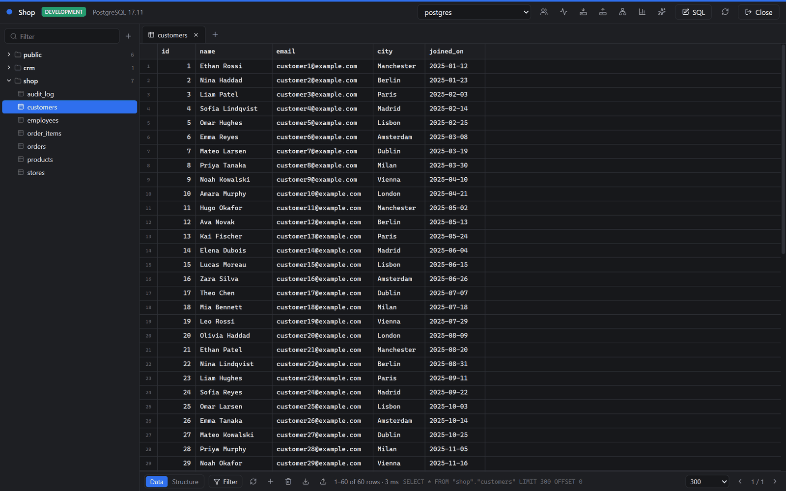
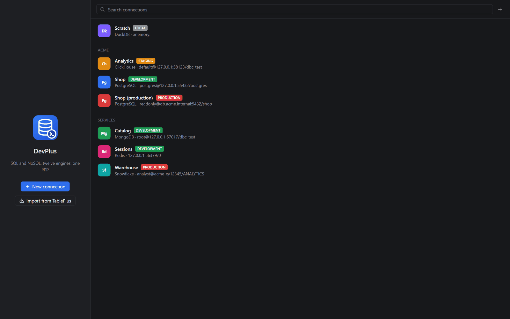
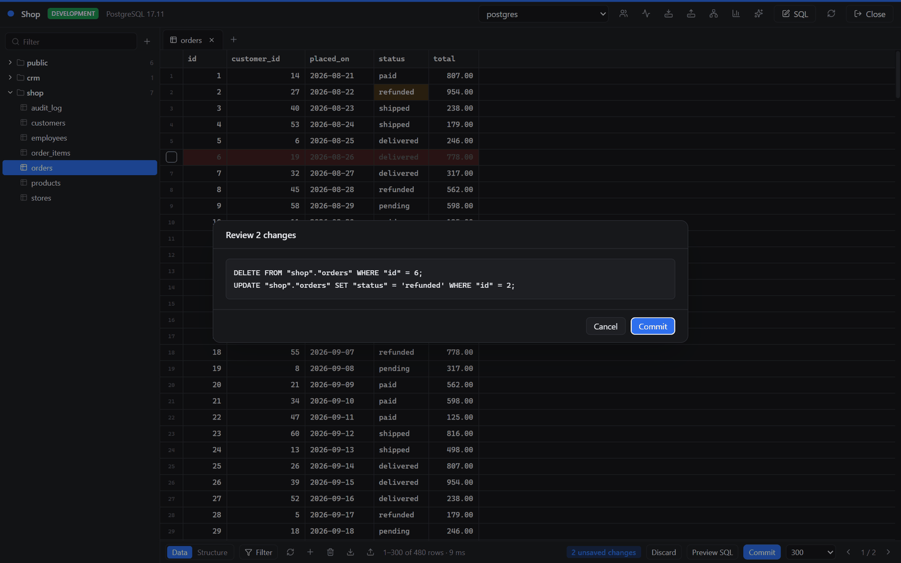
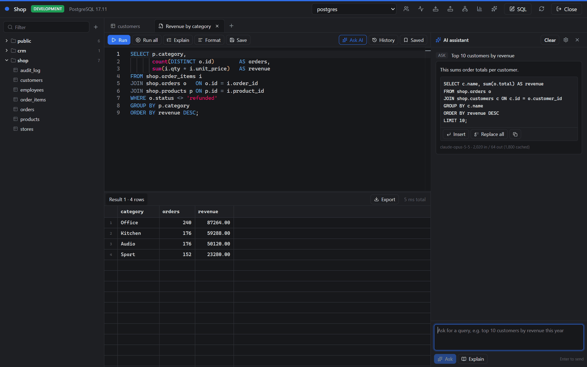
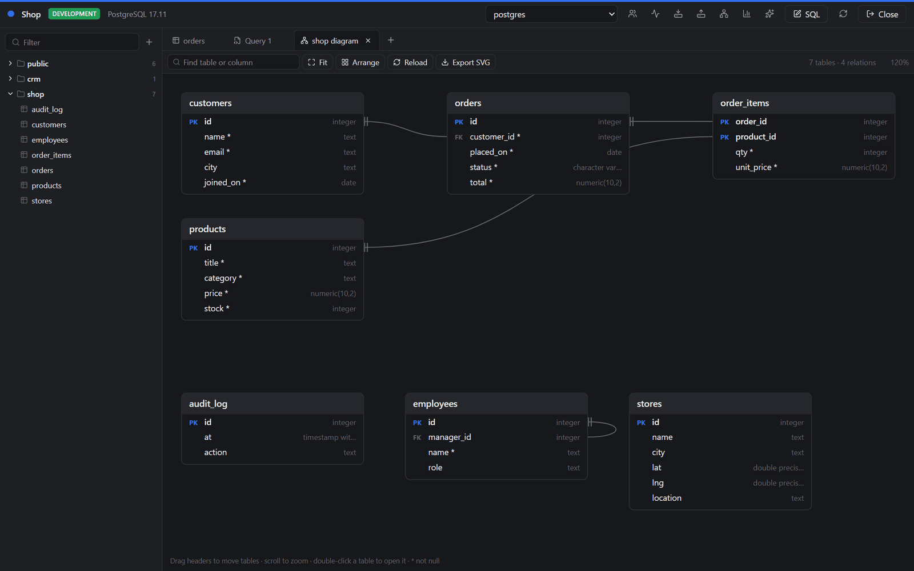
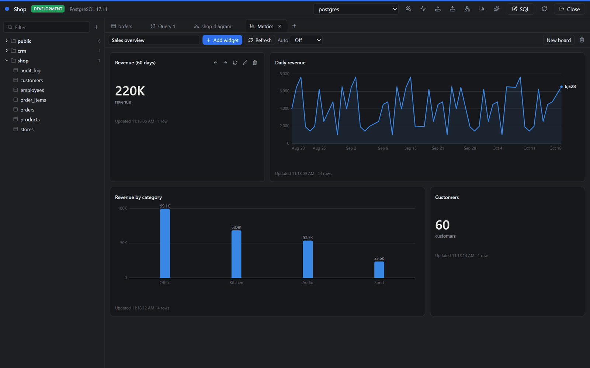
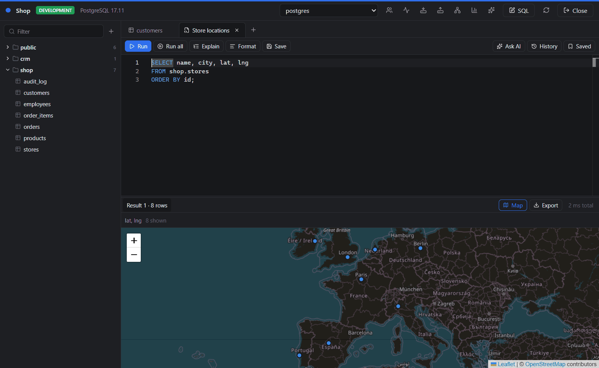
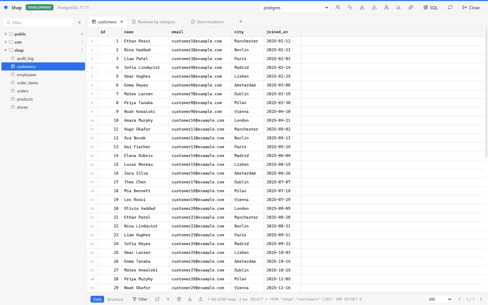

# DevPlus

A fast, native-feeling desktop client for SQL and NoSQL databases. Free and open source (GPL-3.0).



## What it does

- **12 engines in one app**: PostgreSQL, MySQL/MariaDB, SQLite, SQL Server, DuckDB, ClickHouse, Snowflake, BigQuery, MongoDB, Redis, Cassandra/ScyllaDB, DynamoDB
- **Spreadsheet-style editing** with every change staged, previewed as SQL and committed in one transaction. **Safe mode** for production connections: confirm every write, or make the connection read-only
- **Query editor** (Monaco): run the statement at the cursor or everything, multiple result sets, schema-aware autocomplete, formatter, explain, cancel, history and saved queries
- **Structure editor** that writes the DDL for you, plus views, functions, users and roles, and a live process list
- **Import and export** CSV, TSV, JSON and SQL; backup and restore through pg_dump and mysqldump; copy rows as INSERT, CSV or JSON
- **AI assistant**, bring your own key (Anthropic, OpenAI, or a local model through Ollama or LM Studio): text to SQL, explain, fix errors. Only table and column names are sent unless you opt in to sample rows, and nothing runs without you
- **Metrics boards** built from saved queries, a **map view** for location columns, and an **ER diagram** per schema
- **SSH tunnels**, SSL, and passwords kept in your OS keychain
- **Plugins** in plain JavaScript (sandboxed), light and dark themes, an accent color, and fully rebindable shortcuts

See [docs/FEATURES.md](docs/FEATURES.md) for the details and known limits of each part.

## Screenshots

| | |
|---|---|
|  |  |
| **Connections** grouped, color-coded and tagged by environment | **Safe editing**: every change is reviewed as SQL before it commits |
|  |  |
| **Query editor** with the AI assistant writing SQL from your schema | **ER diagram** for any schema, exportable as SVG |
|  |  |
| **Metrics boards** built from queries, refreshed on a timer | **Map view** for latitude/longitude, GeoJSON, WKT and PostGIS columns |
|  | |
| **Light theme**, plus your own accent color, fonts and row density | |

## Download

Installers for Windows (x64), macOS (Apple Silicon) and Linux (x64) are published on the [Releases](https://github.com/aashifahd/devplus/releases) page. Installed builds update themselves from there (you can turn this off in Settings → About).

Early builds are not code-signed yet, so Windows SmartScreen and macOS Gatekeeper will warn the first time you open them. See [docs/RELEASING.md](docs/RELEASING.md) for the signing plan.

You can also bring your connections over from TablePlus: on the start screen choose **Import from TablePlus**. Hosts, users, databases, SSH settings and colors come across; passwords never do, you type them on first connect.

## Privacy

- Nothing is sent anywhere unless you use a feature that needs it: connecting to your databases, the AI assistant (to the provider you configure), update checks (to GitHub), and map tiles (OpenStreetMap)
- There is no telemetry. Errors are written to a local log (Settings → About → Open logs folder); "Report a problem" opens a GitHub issue for you to review before anything is sent

## Build from source

Requires Node.js 22 or newer.

```bash
npm install
npm run dev
```

| Command | What it does |
|---|---|
| `npm run dev` | Run with hot reload |
| `npm run typecheck` | Type-check main, preload and renderer |
| `npm run build` | Production bundle into `out/` |
| `npm run dist` | Installer for the current OS into `dist/` |
| `npm run notices` | Regenerate third-party notices and check dependency licenses |

App data lives in your user data folder (`%APPDATA%\DevPlus` on Windows, `~/Library/Application Support/DevPlus` on macOS, `~/.config/DevPlus` on Linux): `connections.json`, `secrets.json` and `ai-keys.json` (both encrypted), `settings.json`, `metrics.json`, `history.json`, `saved-queries.json`, `plugins/` and `logs/`.

## Project layout

- `src/main/drivers/*`: one adapter per engine behind `DriverSession`; `sql.ts` and `ddl.ts` build SQL per dialect
- `src/main/ipc.ts`: every channel from `src/shared/api.ts`; errors come back as values
- `src/main/ai/*`: schema context and the AI providers
- `src/main/updater.ts`, `src/main/logs.ts`: auto-update and local error logs
- `src/main/importers/*`: connection importers (TablePlus)
- `src/shared/*`: types, engine registry, SQL splitting, formats, geometry and chart helpers shared by both processes
- `src/renderer/src/*`: the React UI

## Contributing

Bug reports and ideas are welcome from everyone as issues. Pull requests are open to collaborators; [CONTRIBUTING.md](CONTRIBUTING.md) explains how to become one; security issues go through [SECURITY.md](SECURITY.md). The plan for what comes next is in [docs/ROADMAP.md](docs/ROADMAP.md).

## License

[GPL-3.0-or-later](LICENSE). Third-party notices ship inside the app and are generated with `npm run notices`.

This is an independent project, written from scratch. It is not affiliated with or endorsed by TablePlus or any database vendor; product names are trademarks of their owners and are used only to describe compatibility.
